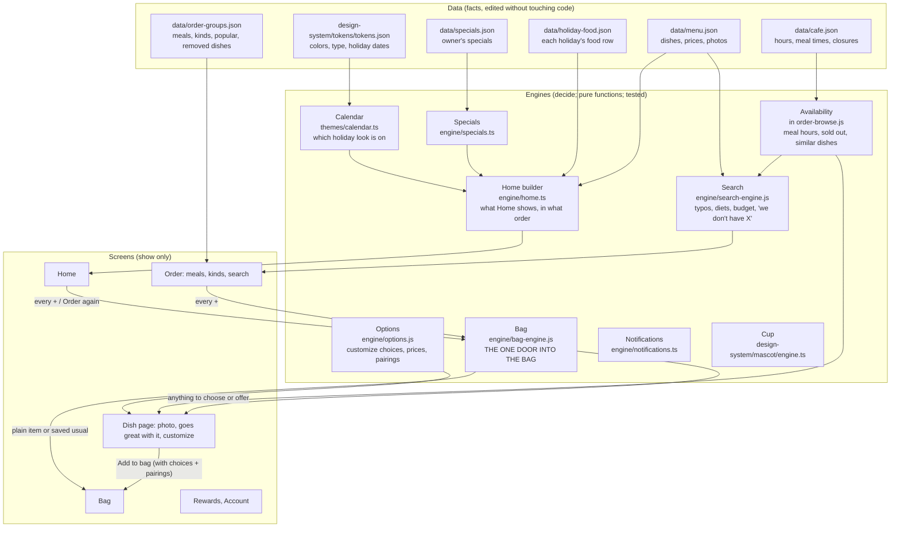

# How the app is put together

The rule behind everything: **screens show things, engines decide things, data holds the facts.**
A screen never makes a decision another screen also makes. If two screens need the same behavior,
that behavior is an engine, and both screens call it. That is why the Home "+" can never again
work differently from the Order "+".

## System map

## The bag engine: the one door

Every "+", "Add" and "Order again" button calls `toBag(id)`, which asks `Bag.plan()`:

| Situation | What happens |
|---|---|
| Not available now (sold out, outside meal hours) | Dish page opens and says why, with similar dishes |
| "Order again" on the usual, with saved choices | Added exactly as saved (e.g. Dirty chai · Iced · Oat milk) |
| Something must be picked (eggs, protein) | Dish page opens |
| Anything to offer (customize, "Goes great with it") | Dish page opens |
| Plain item, nothing to choose or pair | Added straight away |

Only two places may put a line in the bag: `toBag()` and the dish page's Add button (`bagPush`).

## Guards that stop this from slipping again (run daily)

- `engine/bag.test.mjs`: the rule above, plus a check of the built app. If any screen calls `bagPush` directly, the test fails.
- `tools/qa/ui-check.mjs`: clicks every + on Home (every holiday) and in every meal on Order. It fails if a + skips the dish page.
- `tools/qa/calendar-check.mjs`: every holiday's dates for five years. It also checks each holiday has a food row whose items are on the menu.
- Text overflow, spelling and grammar, and security checks: see `tools/qa/README.md`.

## Adding something new

1. **New fact?** Put it in `data/` or `tokens.json`. Never put it in screen code.
2. **New decision two screens could need?** Make it an engine with tests, and have both screens call it.
3. **New button that adds food?** It must call `toBag(id)`. The tests fail otherwise.
4. Add a daily check for it in `tools/qa/`.

## Where the mockup fits

`mockup/index.html` is the clickable demo. It is built from these same engines and data files, so what you see there is what the real app (React Native + Toast) will do.
